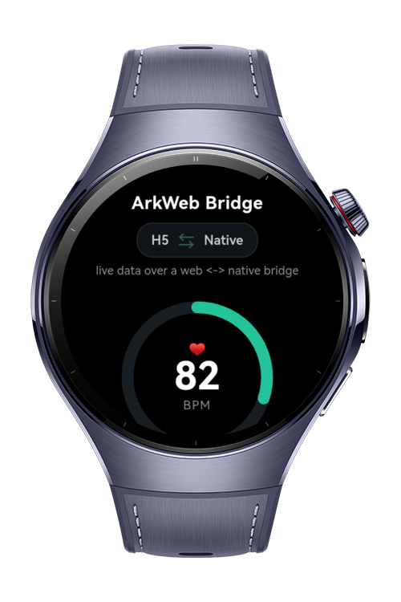
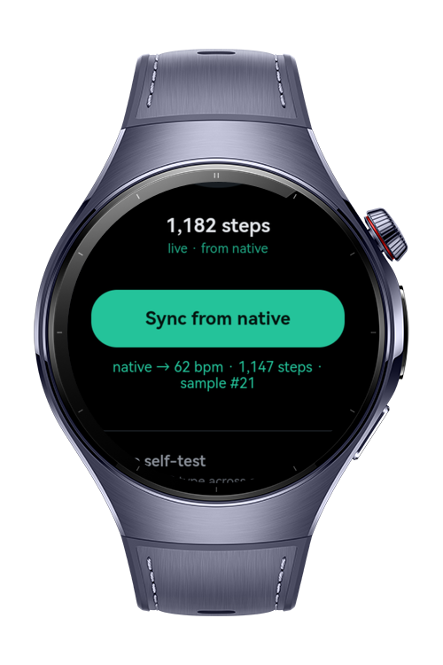
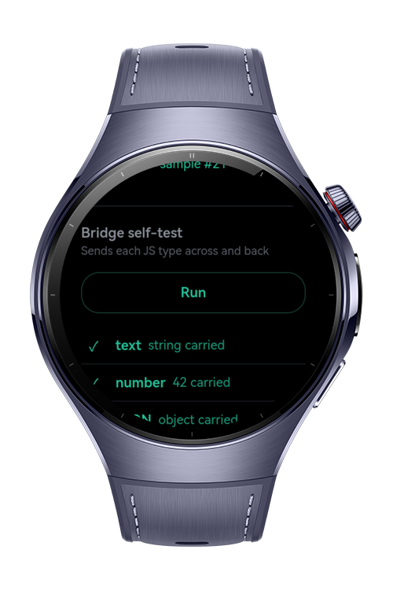

> **Note:** To access all shared projects, get information about environment setup, and view other guides, please visit [Explore-In-HMOS Index](https://github.com/Explore-In-HMOS/hmos-index).

# How To Build Arkweb Native Bridge

**How To Build Arkweb Native Bridge** (`how_to_build_arkweb_native_bridge`) is a HarmonyOS wearable app that demonstrates bi-directional communication between a locally-bundled H5 page rendered inside an ArkWeb `Web` component and native ArkTS, using the `@ohos.web.webview` bridge APIs from `@kit.ArkWeb`.

The app hosts a single-screen health tile whose UI lives in a bundled `index.html`. Native ArkTS pushes simulated heart-rate and step values into the page over a live message-port channel, serves on-demand sensor snapshots through a custom `wearable://` scheme handler, and runs a typed round-trip self-test where string, number, JSON, ArrayBuffer, and Error values cross the bridge and return. All sensor readings are simulated in native code, so no hardware or permissions are involved.

# Preview

<div>
  
  
  
</div>

# Use Cases

- **Live native push**: Native ArkTS streams simulated heart-rate and steps into the H5 page every second over a web message-port channel.
- **On-demand fetch**: The page calls `fetch('wearable://sensor')` and a native custom scheme handler answers with a fresh JSON sensor snapshot.
- **Typed round-trip self-test**: String, number, JSON, ArrayBuffer, and Error values are sent web to native and back to prove typed `WebMessageExt` get/set.
- **Live bridge indicator**: A top `H5 <-> Native` indicator glows on each message crossing so the learner can see traffic in both directions.

# Technology

## Stack

- **Languages**: ArkTS / ArkUI
- **Frameworks**: HarmonyOS SDK 6.0.1(21)
- **Tools**: DevEco Studio 6.x+
- **Libraries**:
  - `@kit.ArkWeb`
  - `@kit.ArkTS`
  - `@kit.BasicServicesKit`

## Required Permissions

No permission required. The page and all sensor data are bundled and simulated locally.

# Directory Structure

```
entry/src/main/
|---ets
|   |---entryability
|   |   |---EntryAbility.ets
|   |---model
|   |   |---BridgeMessage.ets
|   |---pages
|   |   |---BridgeDemo.ets
|   |---services
|   |   |---MockSensorService.ets
|   |   |---SchemeHandlerFactory.ets
|---resources
|   |---rawfile
|   |   |---index.html
```

The H5 UI and its bridge glue code are bundled at `entry/src/main/resources/rawfile/index.html` and loaded locally by the `Web` component.

# Constraints and Restrictions

## Supported Devices

- Huawei Watch 5
- DevEco Studio wearable simulator
- The `Web` component runs on phones, wearables, and TVs, but not on PC/2in1 devices.

# License

**How To Build Arkweb Native Bridge** is distributed under the terms of the MIT License.
See the [LICENSE](/LICENSE) for more information.
